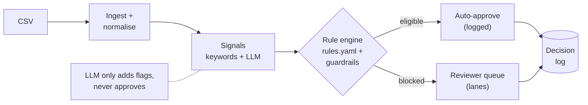
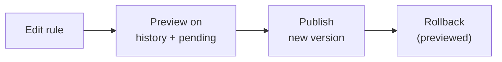

# Refund triage

Decides which refund requests can be approved automatically and sends the rest to a person, with the reason.
Includes the two mechanisms from the brief: a **reviewer queue** and a **policy manager** who changes rules
without an engineer and previews the impact before anything goes live.

**Write-up:** [docs/slides.pdf](docs/slides.pdf) (8 slides) · **Screen recording:** [Watch on Google Drive](https://drive.google.com/file/d/1Yq1tbDcB_uL04jM9WrIch4Le6q6c4ZgH/view?usp=sharing) (≈4 min)

## Run

Needs [uv](https://docs.astral.sh/uv/) (it installs Python 3.12 and the dependencies on first run).

```bash
uv run refunds run data/pending.csv          # decide a file -> prints routing, writes out/decisions.csv
uv run streamlit run app/streamlit_app.py    # clickable demo at http://localhost:8501
uv run pytest                                # 172 tests
```

`refunds run` accepts any CSV with the same columns as `pending.csv`. The demo can load one too (sidebar, "Requests file").

### API key (optional)

```bash
cp .env.example .env    # then set ANTHROPIC_API_KEY=...
```

- **With a key:** the note reader calls `claude-haiku-5-5` for notes it hasn't seen, and the policy manager's
  "Describe it in English" box can draft rules.
- **Without a key:** everything still runs. The note reader uses the committed cache of LLM results
  (`llm_cache/`, covers history and pending). Notes not in the cache are flagged "unreadable" and go to a person.
  `--no-llm` forces the keyword fallback instead. The English rule box is off; the form builder and quick changes work.

Other commands: `refunds models` (checks which configured models the key can use), `refunds eval-notes [--heldout]`,
`refunds backtest`.

## How it works

**Deciding a request**



**Changing a rule (policy manager)**



- **The money decision is deterministic.** `src/refunds/engine.py` applies the rules in `rules/rules.yaml`.
  A case is auto-approved only if an `eligible` rule matches and no `block` rule fires (apart from ones that the
  eligible rule explicitly overrides). Three locked rules (bad data, duplicates, warning signs in notes) can't be
  switched off or overridden. Guardrails in `config.yaml` (global max per auto-approval, kill switch) sit above the
  rules and are engineer-owned.
- **Lanes have a fixed priority** (fraud > data > notes > carrier > partial > policy), so the order of rules in
  the file can't change routing.
- **The LLM** (`src/refunds/llm.py`) reads both notes and returns warning flags with evidence as strict JSON.
  The schema has no way to say "approve". Notes are treated as untrusted data (RF-1073 contains a fake "system note";
  it's flagged `injection_attempt` and goes to a person). Any LLM failure means the case goes to a person.
- **Two layers read every note.** A keyword scan (`src/refunds/signals.py`) always runs; the LLM adds flags on top and
  can't remove any. When both find the same sign, the card shows both pieces of evidence, each labelled with its source.
  The keyword layer is the floor if the LLM misses something or is down.
- **Guidance, not a default.** The case card shows what policy suggests (`src/refunds/suggest.py`), but the decision
  form starts empty, so the reviewer makes an active choice instead of confirming a preselected answer (automation
  bias). Going against the suggestion needs a note. A prompt-injection note is treated as a fraud signal (suggest:
  escalate), never as grounds to reject; the claim is still decided on its facts (e.g. policy #4 carrier proof).
- **Preview** (`src/refunds/preview.py`) replays history (248 decided requests) and pending under the draft
  rules: cases that change route, $, how many newly auto-approved history cases went wrong before, and reviewer
  minutes saved.

| Folder | What |
|---|---|
| `src/refunds/` | ingest, signals, engine, rules schema, LLM reader, reviewer guidance, preview, versions, CLI |
| `rules/` | the live rule set (`rules.yaml`) |
| `app/` | Streamlit demo |
| `eval/` | labelled note sets and results (`eval/RESULTS.md`) |
| `docs/screenshots/` | screenshots of the demo |
| `docs/slides.pdf` | the 8-slide write-up (source: `docs/slides/slides.html`; notes: `docs/SPEAKER_NOTES.md`) |
| `docs/RECORDING_SCRIPT.md` | script for the screen recording |

## The line (rules v1)

Auto-approve only: wrong size, change of mind (both within 14 days), wrong item, damaged (not electronics; photo
confirmed by staff if over $50), **up to $75**, no refunds in the last 12 months, fraud flag "no", clean data, no
warning signs in the notes. Everything else goes to a person.

Backtest on 248 decided requests: 106 auto-approved (43%, $3,346), 0 that went wrong historically (chargebacks,
correct rejections, partials, policy violations). The old rule auto-approved 111, with 4 wrong approvals: 1 chargeback ($74) and 3 refunds against policy ($156).
Pending: RF-1069 and RF-1071 auto-approved, 19 to a person. Details in `PLAN.md` and `eval/RESULTS.md`.

## AI: where it's used and where it isn't

| Used | Not used |
|---|---|
| Reading free-text notes into warning flags (multilingual, phrased many ways) | The approve / route decision |
| Drafting a rule from the manager's English (she confirms and previews) | Parsing amounts, dates, reasons, flags |
| One-line English summary on the reviewer's card, labelled "verify" | Anything that can approve money |

Model: `claude-haiku-5-5`, about $0.0002 per request (one call reads both notes). On the labelled development set it caught 41/41 notes with
warning signs (keyword fallback: 36/41) with 0/27 false flags; on a held-out set written and labelled before
running, 12/12 with 0/7 false flags. Sonnet 5.5 cost about 20x more and missed a chargeback note.
Caveats and the full numbers: `eval/RESULTS.md`.

## What's mocked or simplified

- **"Request info" and "Escalate"** record the action and keep the case open as "waiting" / "escalated". No message
  is sent to the customer, fraud team or carrier.
- **Photo evidence and fraud-team confirmation** are read from the support agent's note with strict phrase matching.
  In a real system they'd be structured fields (photo attached; fraud team verdict).
- **Audit sample:** auto-approvals are marked for audit, but there's no separate audit screen.
- **Single user, no auth.** The reviewer name is a text box. Demo state (live rules, versions, decisions) lives in
  `out/demo/`; "Reset demo state" in the sidebar restores the seed rules.
- Everything else in the demo is wired to the real engine, rules, preview and decision log.

## Assumptions

- **Wrong size follows the change-of-mind return window (14 days).** Policy note #2 names only change of mind.
  Editable as the `return_window` rule.
- **Late deliveries always go to a person** (policy #6: partials are the reviewer's call).
- **Blank fraud flag = unknown**, routed to the fraud team, never treated as "no".
- **Slashed dates are DD/MM/YYYY**, inferred from their position among ISO-dated rows in history.csv.
- **History is not ground truth.** "Went wrong" combines outcomes (chargebacks, appeals, partials) with the
  written policy. Auto-approved history cases were never reviewed, so errors there are under-counted; that's why
  launch would be shadow mode plus an audit sample.
- **Exact duplicate rows in history** (3) are export artefacts and are dropped; repeated IDs in new requests are kept
  and sent to a person.

## How I used AI coding tools

I built this with Claude Code: planning, data profiling, code, tests and the demo. I reviewed each phase before
the next one, and kept a running log of what I changed or threw away in `AI_NOTES.md`.

**What I changed: RF-1073.** RF-1073 is a never-arrived claim whose customer note contains a fake "system note"
telling the agent to approve and skip review. The reviewer card the assistant built suggested **Reject** for it. That
contradicted the card's own advice to "ignore it and decide on the facts", and policy #4, which says a never-arrived
claim is decided on the carrier's proof of delivery. An injection attempt is a reason for suspicion, not a verdict.
I changed the suggestion to **Escalate** (fraud signal) plus the carrier check (policy #4), moved the guidance into a
testable module (`src/refunds/suggest.py`), and added tests that an injection note never leads to a suggested reject
or approve (`tests/test_suggest.py`). At the same time I stopped the decision form from preselecting the suggestion,
to avoid automation bias.

**What I threw away: "Haiku 5.5 doesn't exist."** When planning the model comparison, the assistant told me
"Haiku 5.5 doesn't exist" and wanted to compare Haiku 4.5 instead. I disagreed, and had it check the live API (`refunds models`): `claude-haiku-5-5` was
available and Haiku 4.5 wasn't even enabled on my key. Haiku 5.5 ended up being the model we chose. Lesson:
check model IDs against the API, not the assistant's memory. Other entries: I replaced its rule-order-dependent
routing with fixed lane priority, and added system guardrails above the rules after noticing an override could
auto-approve any amount.
